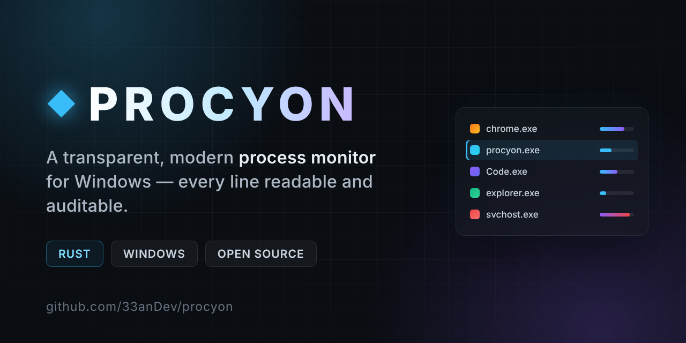

<div align="center">



# ◆ Procyon

**A transparent, open-source process monitor — built in Rust.**

*An open, auditable window into everything running on your machine.*

</div>

---

## Why

The process-inspection tools floating around the internet are often opaque
binaries you're expected to trust blindly — and a worrying number of them ship
with a backdoor or trojan bundled in. Procyon is the opposite: a small, clean,
fully open codebase where you can read exactly what it does before you run it.
Nothing hidden, nothing phoning home.

It's also just a fun systems-programming project.

## What it does today

- **Live process list**: name (with the app's real icon), PID, parent PID, CPU %, memory, user
- **Search** by name or PID
- **Sort** by any column (click the header to toggle direction)
- **Right-click actions**: set priority, suspend / resume, end process or a
  whole process tree, open file location, copy PID / name / path
- **Header stats**: machine-wide CPU (with a live sparkline), memory, process count
- A sleek dark UI with a CPU heat bar per row, so busy processes stand out

## Download

Grab the latest `procyon.exe` from the
[**Releases**](https://github.com/33anDev/procyon/releases) page, then just
double-click it — no installer, no setup. Windows may show a SmartScreen
warning for a new unsigned app; click **More info → Run anyway**.

Prefer to build it yourself? See [Build from source](#build-from-source) below.

## Usage

- **Find a process** — start typing in the search box (top right) to filter by
  name or PID.
- **Sort** — click any column header (Name, PID, CPU%, Memory) to sort; click
  again to flip the direction.
- **Select** — click a row to select it.
- **End a process**: select it and click *End process* (bottom right), or
  right-click the row. You'll get a confirmation first.
- **Right-click a row** for everything else:
  - **Set priority**: Realtime, High, Above normal, Normal, Below normal, Idle.
    The current class is highlighted.
  - **Suspend / Resume**: freezes or thaws all of the process's threads.
  - **End process tree**: ends the process and all its descendants
    (children first), after a confirmation showing how many are affected.
  - **Open file location**, **Copy PID / name / full path**.

  Actions the OS won't allow on that process are greyed out (hover for why),
  and every result, success or failure, is shown in the status bar.

The list refreshes automatically, so CPU% and memory stay live. It pauses
re-sorting while a context menu is open, so rows don't jump under your cursor.

### What needs administrator rights

Procyon runs fine as a normal user. You can manage any process running under
your own account. Running it **as administrator** additionally allows:

- **Realtime** priority. Without admin, Windows silently applies *High*
  instead; Procyon reads the value back and tells you.
- Changing, suspending or ending **elevated** processes (ones started "as
  administrator") and **services / other users'** processes.

Protected system processes (e.g. *System*, *csrss*, anti-malware services)
stay off-limits even as administrator. That's Windows protecting itself.

Use Suspend with care: suspending something your desktop depends on (e.g.
`explorer.exe`, `dwm.exe`) can make the session appear frozen until it's resumed.

## Build from source

Requires a [Rust toolchain](https://rustup.rs/) (stable).

```bash
git clone https://github.com/33anDev/procyon
cd procyon
cargo run --release
```

That's it — no extra setup. The compiled binary lands in
`target/release/procyon.exe`.

`cargo test` runs Windows integration tests for the process actions. They
spawn a throwaway `ping` process and set its priority, suspend/resume and end
it, so no admin rights are needed.

## Project layout

```
procyon/
├── Cargo.toml              # workspace root
└── crates/
    └── procyon-ui/         # the process monitor (this crate)
        └── src/
            ├── main.rs     # window + entry point
            ├── app.rs      # UI: header, table, context menu, status bar, dialogs
            ├── process.rs  # data layer (sysinfo wrapper, snapshots, process tree)
            ├── actions.rs  # OS actions: priority, suspend/resume, terminate (all Win32 code)
            ├── icons.rs    # exe icon extraction (background thread) + texture cache
            └── theme.rs    # palette, fonts & styling
```

All `unsafe` Win32 code lives in `actions.rs` and `icons.rs`, behind
`#[cfg(target_os = "windows")]`, with a `SAFETY:` note on every block. On other
platforms the crate still builds: suspend/resume fall back to
SIGSTOP/SIGCONT, priority is greyed out, and icons show a placeholder.

The workspace is set up so future crates slot in cleanly without restructuring.

## Roadmap

- [x] **v0.1** — live process monitor (list, search, sort, kill)
- [x] **Process actions**: priority, suspend/resume, end tree, open location, copy
- [x] **A nicer UI pass**: new theme, real process icons, CPU heat bars
- [ ] **Per-process module view**: see the DLLs each process has loaded
- [ ] **Richer detail**: threads, handles, integrity level, command line
- [ ] **Readable user names** instead of raw SIDs in the User column

## Scope & intent

Procyon is for understanding your own system: debugging, learning how the OS
works, and inspecting what's running on a machine you control. Keep it honest —
it's a tool for your own machine, not for tampering with software you don't own.

## License

MIT — see [LICENSE](LICENSE).